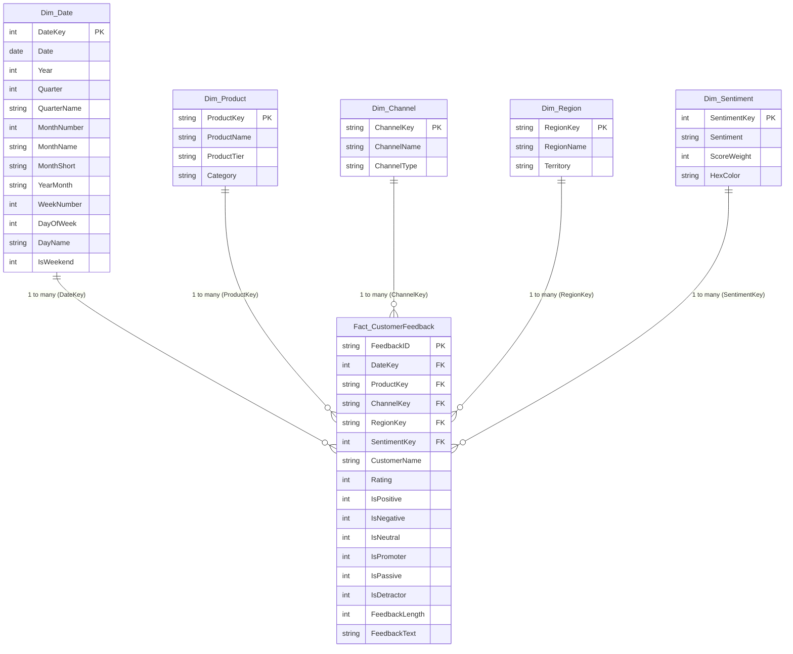

# Power BI Data Modeling Architecture

## 1. Architectural Decision: Single Flat Table vs. Star Schema

In Business Intelligence engineering, choosing between a flat table and a dimensional model depends on dataset volume, analytical complexity, and maintenance overhead.

```
┌────────────────────────────────────────────────────────────────────────┐
│                        ARCHITECTURAL COMPARISON                        │
├──────────────────────────┬─────────────────────────────────────────────┤
│ Single Flat Table        │ Dimensional Star Schema                    │
├──────────────────────────┼─────────────────────────────────────────────┤
│ • 1 table (All columns)  │ • 1 Fact Table + 5 Dimension Tables         │
│ • Zero relationship setup│ • Standard 1-to-Many (1:*) Relationships    │
│ • Simple for quick demos │ • Enterprise standard for VertiPaq engine   │
│ • Higher memory per row  │ • 5x-10x dictionary compression on text    │
│ • Time Intelligence hard │ • Dedicated Date Table for Time-Series DAX │
└──────────────────────────┴─────────────────────────────────────────────┘
```

### Recommendation for This Project
1. **Initial / Simple Setup:** Use `cleaned_customer_feedback.csv`. It requires zero relationship configuration in Power BI and works immediately for small-to-medium datasets (< 500,000 rows).
2. **Enterprise / Interview Standard:** Use the **Star Schema** (`Fact_CustomerFeedback` + `Dim_*`). It demonstrates data modeling competence, optimizes storage in Microsoft's **VertiPaq** engine, and supports advanced DAX Time Intelligence.

---

## 2. Star Schema Entity-Relationship Model



---

## 3. Relationship Details & Cardinality

| From Table (Dimension) | From Column | To Table (Fact) | To Column | Cardinality | Cross-Filter Direction | Active |
|---|---|---|---|---|---|---|
| `Dim_Date` | `DateKey` | `Fact_CustomerFeedback` | `DateKey` | 1 to Many ($1:*$) | Single (Dimension $\rightarrow$ Fact) | Yes |
| `Dim_Product` | `ProductKey` | `Fact_CustomerFeedback` | `ProductKey` | 1 to Many ($1:*$) | Single (Dimension $\rightarrow$ Fact) | Yes |
| `Dim_Channel` | `ChannelKey` | `Fact_CustomerFeedback` | `ChannelKey` | 1 to Many ($1:*$) | Single (Dimension $\rightarrow$ Fact) | Yes |
| `Dim_Region` | `RegionKey` | `Fact_CustomerFeedback` | `RegionKey` | 1 to Many ($1:*$) | Single (Dimension $\rightarrow$ Fact) | Yes |
| `Dim_Sentiment` | `SentimentKey` | `Fact_CustomerFeedback` | `SentimentKey` | 1 to Many ($1:*$) | Single (Dimension $\rightarrow$ Fact) | Yes |

### Why Single Cross-Filter Direction?
- **Best Practice:** Best practice in Power BI is to always keep relationships **Single**, where filters flow from the dimension table to the fact table.
- **Bi-directional Risks:** Bidirectional filtering can introduce ambiguity, circular filter paths, and unpredictable DAX measure calculations.
- **Performance:** Single direction allows the VertiPaq engine to traverse indexes with maximum cache locality.

---

## 4. Column Formatting & Sort-By Specifications

In Power BI Desktop, ensure the following sort-by configurations are set:

1. **`Dim_Date[MonthName]`**: Set **Sort by Column** $\rightarrow$ `Dim_Date[MonthNumber]`.  
   *(Prevents alphabetical ordering like April, August, December; ensures chronological ordering January, February, March).*
2. **`Dim_Date[QuarterName]`**: Set **Sort by Column** $\rightarrow$ `Dim_Date[Quarter]`.
3. **`Dim_Date[DayName]`**: Set **Sort by Column** $\rightarrow$ `Dim_Date[DayOfWeek]`.
4. **Mark as Date Table**: Right-click `Dim_Date` in Fields pane $\rightarrow$ **Mark as Date Table** $\rightarrow$ select `Date`. This unlocks native DAX Time Intelligence functions without relying on Power BI's hidden auto-date/time tables.
